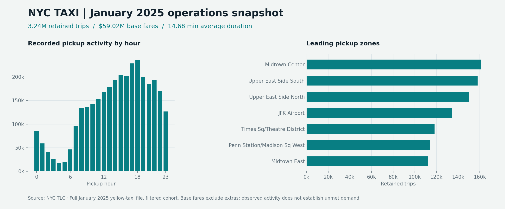

# NYC Taxi Operations Analytics

**An end-to-end data analyst portfolio project using Python, SQL, and a filterable dashboard.**

Turn 3.48 million official yellow-taxi trip records into an auditable view of pickup activity and recorded base fares. The business objective is to help a hypothetical fleet operations manager choose locations and hours for a dispatch pilot.

[Open the dashboard](dashboard/index.html) · [Read the findings](reports/findings.md) · [Review the methodology](docs/methodology.md) · [Power BI build guide](powerbi/README.md)

> Download or clone this repository and open `dashboard/index.html` in a browser. GitHub's file viewer displays HTML source; it does not execute the dashboard. All dashboard data is embedded, so no server or database is needed to explore it.



## Results at a glance

| January 2025 cohort | Result |
|---|---:|
| Input records | 3,475,226 |
| Retained trips | 3,242,053 |
| Recorded base fares | $59.02 million |
| Average trip duration | 14.68 minutes |
| Leading pickup zone | Midtown Center |
| Busiest pickup hour | 18:00–18:59 |

These are descriptive results, not a claim of improved dispatch performance. Base fares are not net profit. See the generated findings for exact values and limitations.

## What the project demonstrates

- **Data preparation:** reproducible download, source checksums, nonfinite/null checks, ordered exclusions, a zone-dimension join, and a sensitivity comparison.
- **SQL:** CTEs, grouped metrics, left joins, ranking, `LAG`, rolling windows, and additive aggregates that reconcile across filter combinations.
- **Business intelligence:** coordinated borough/day-type filters, metric switching, a zone leaderboard, an audit panel, and downloadable filtered CSVs.
- **Communication:** metric definitions, source attribution, an explicit decision hypothesis, and limitations that distinguish observed activity from unmet demand.
- **Quality assurance:** unit tests for cleaning boundaries plus full-output reconciliation and dashboard filter checks.

## Explore without installing anything

1. Download this repository as a ZIP and extract it.
2. Open `dashboard/index.html` in Chrome, Edge, or Firefox.
3. Select a borough and day type. Switch charts between trip count and base fare revenue.
4. Review the audit, then download the filtered aggregate data.

## Rebuild the analysis

Python 3.12 is the tested runtime. From this repository's root:

```sh
python -m venv .venv
```

Activate on Windows PowerShell:

```powershell
.venv\Scripts\Activate.ps1
```

Or on macOS/Linux:

```sh
source .venv/bin/activate
```

Install, rebuild, and test:

```sh
python -m pip install -r requirements.txt
python src/pipeline.py
python -m unittest discover -s tests -v
```

The first run downloads approximately 59 MB of official Parquet data and the zone lookup. Allow roughly 1 GB of available memory for local processing; requirements vary by machine. An internet connection is required to install dependencies and download source files. Subsequent runs reuse local raw inputs; `--skip-download` explicitly requires them to exist. Outputs overwrite the previous analysis. To refresh publisher-revised files, delete the raw inputs and rerun; compare the resulting source manifest.

DuckDB executes the SQL over the official Parquet data locally. There is no cloud account, paid API, credential, or externally hosted database required.

## Optional browser checks

```sh
python -m pip install playwright==1.51.0
python -m playwright install chromium --only-shell
python tests/browser_check.py
```

This checks all 18 borough/day combinations, the measure switch, CSV downloads, mobile width, and JavaScript errors. A browser download is required. Transient QA screenshots are saved outside the repository. To regenerate the static chart above, install `matplotlib==3.10.8` and run `python src/plot_snapshot.py`.

## Repository map

| Path | Purpose |
|---|---|
| `src/pipeline.py` | Source download, SQL execution, exports and findings generation |
| `src/dashboard.html` | Editable dashboard template |
| `sql/01_clean.sql` | Cohort definition and row-level quality classification |
| `sql/02_daily.sql`–`09_zone_segments.sql` | Analysis queries, cube and sensitivity exports |
| `dashboard/index.html` | Complete standalone dashboard built from real results |
| `reports/` | Generated CSVs, JSON, findings and source checksums |
| `tests/test_pipeline.py` | Cleaning and published-output checks |
| `powerbi/` | DAX measures and manual Power BI model/build instructions |
| `docs/methodology.md` | Metric contract, exclusions and limitations |
| `docs/interview-guide.md` | Questions to understand before presenting this project |

## Power BI scope

The project includes CSV exports, DAX measures, and model instructions for recreating the dashboard in Power BI Desktop. **A `.pbix` file is not included.** The delivered working dashboard is HTML/JavaScript. Power BI instructions are documented but were not executed in this environment.

## Data and attribution

[NYC Taxi & Limousine Commission Trip Record Data](https://www.nyc.gov/site/tlc/about/tlc-trip-record-data.page), January 2025 yellow taxis, plus the official Taxi Zone Lookup Table. Source URLs and hashes are in `reports/source_manifest.json`. The full source file is processed, not sampled. TLC notes that providers supply the records and does not guarantee their accuracy or completeness.

Source data is excluded from Git; derived aggregate outputs are included for immediate review. The MIT license applies to project code and original documentation, not the underlying TLC data.

## Development note

Prepared for Oviya Elangovan with AI-assisted implementation and documentation. Anyone presenting this work should run the project, verify the results, and understand the analytical choices. Automated checks cover the implementation; they do not validate a dispatch policy or establish business impact.

